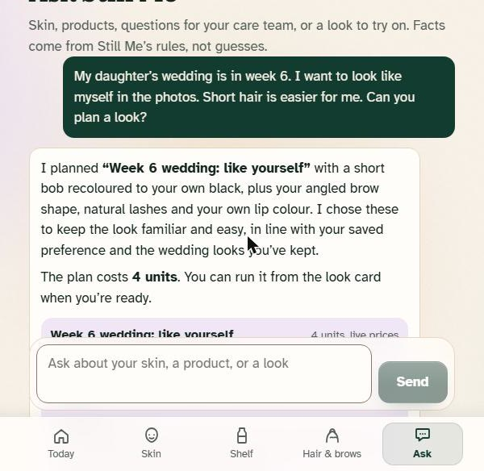
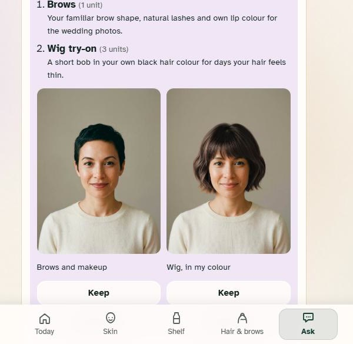
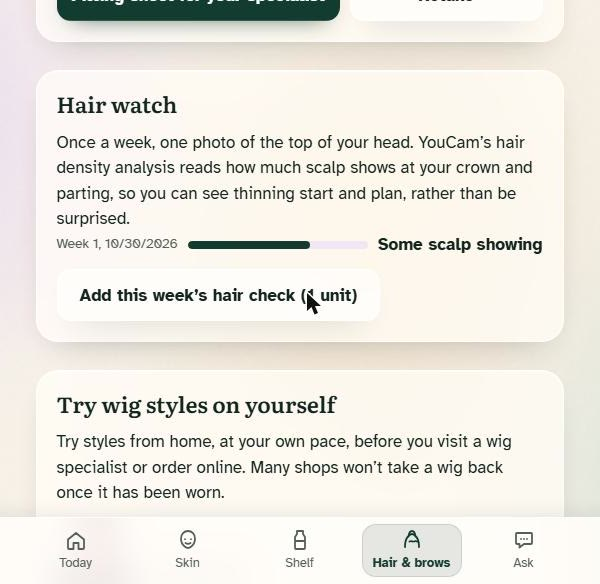
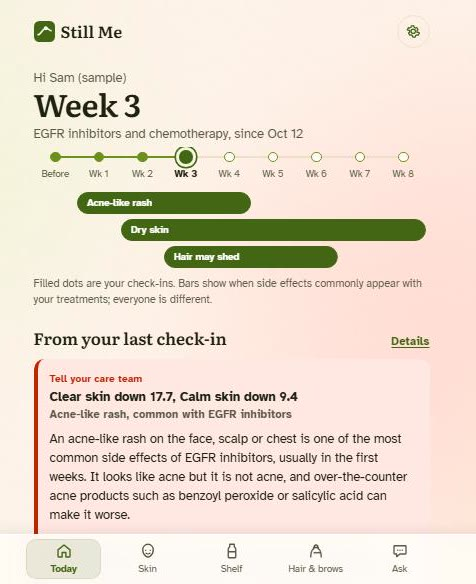
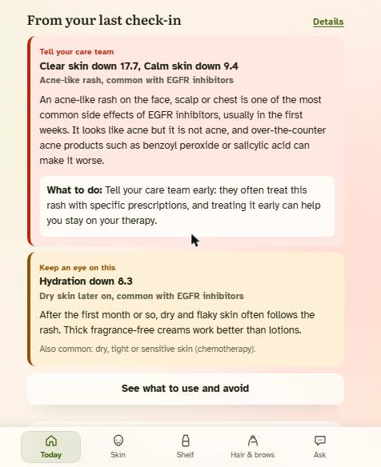
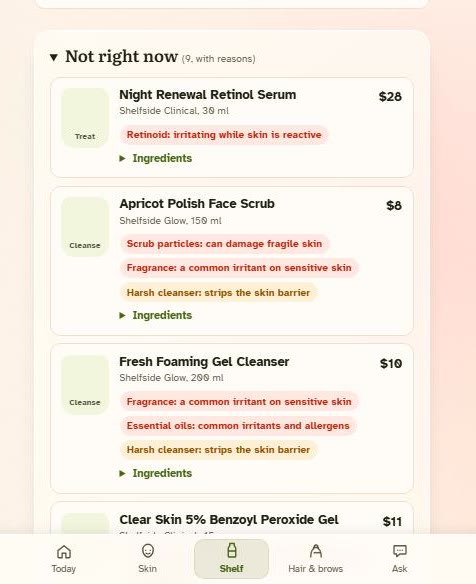

# Still Me

**Skin, hair and brow care through cancer treatment, built on the YouCam API and its MCP servers.**

**Live demo:** https://ahead-skinai.onrender.com (the access code is in the submission). The project was called Ahead until 30 Oct 2026; the URL kept the old name.

## For the judges, in one minute

| Criterion | What Still Me shows |
| --- | --- |
| **Technological implementation** | 10 YouCam AI features: 6 over REST and 4 through YouCam's hosted MCP servers (beauty and fashion), plus live unit prices read through MCP. A companion agent calls Still Me's own rule engines as tools and proposes YouCam try-ons that run only after a tap. Every YouCam task is deleted once its result is downloaded. 72 automated tests. |
| **Design** | One journey for one person: a print of their own hair and brows before treatment, weekly skin and hair checks, try-ons for what comes next, and printable pages for the wig fitter, the insurer and the care team. Mobile first, three colour themes, reduced-motion aware. |
| **Potential impact** | For people starting chemotherapy, radiation or targeted therapy. A generic skin app reads an EGFR-inhibitor rash as acne and sells products that make it worse. A wig chosen after hair loss can't be matched to the person's own hair, and usually can't be returned once worn. |
| **Quality of idea** | Skin AI read against the treatment and the week, not a generic score. Try-on used to keep a person recognisable to themselves: their own brows drawn back, a wig in their own colour, earrings to frame the face, and how hair might grow back. |

The woman on the welcome page is AI-generated (KIE, Nano Banana 2), not a real person. Colour themes (Lotus, Orchard Market, Cream) are in Settings and on the welcome page.

Most people starting chemotherapy, radiation or targeted therapy are told their skin, hair and brows will change. Very few are told what that will look like, which changes matter, or what is safe to buy. Still Me is a mobile web app for that moment:

- **Hair & Brow Print.** Before hair changes, one selfie records hair colour family, brow colour, brow shape, brow thickness and face shape, using YouCam Facial Color Tones and Face Attributes analysis.
- **Try-before-you-buy for hair loss.**
  - Wig styles on your own face, from YouCam templates or any shop's wig photo.
  - Hats, caps and headbands from any shop.
  - Your own brows drawn back on, with the brow pencil closest to your measured colour.
  - A printable fitting sheet for your wig specialist.
- **Skin Watch.** A weekly selfie is scored on eight signals by YouCam AI Skin Analysis. Still Me filters out photo-to-photo noise, then reads what's left in light of *your* treatment and week: what it commonly means, what to do, and when to tell your care team.
- **Gentle shelf.** Every product's ingredient list is checked against your treatment and latest check-in, and products can be saved to a list your care team can check.
- **Care-team summary.** Scores, notes, questions and planned products on one printable page.

| | | |
| --- | --- | --- |
| <br>**Ask Still Me** plans a look from your own print, with the live YouCam unit cost. | <br>**Run, then keep or reject.** A wig in your own colour (Hairstyle + Hair Color via MCP) and your own brows and lips. | <br>**Hair watch** reads scalp visibility each week (Hair Density via MCP). |
| <br>**Today**: the treatment timeline, week 3 of the labelled sample journey. | <br>**A score drop read against the treatment**: the EGFR rash, with "tell your care team". | <br>**Gentle shelf**: products that would make it worse move to *Not right now*, with the reason. |

The sample journey (Sam) is labelled as a sample in the app. The other screenshots are live YouCam results on an AI-generated portrait (the welcome page woman), never a real person.

## The problem, specifically

A generic skin app sees a falling "acne" score and sells you benzoyl peroxide. For someone on an EGFR inhibitor (cetuximab, erlotinib, osimertinib and others), an acne-like rash in the first weeks is one of the most common side effects, and **over-the-counter acne products such as benzoyl peroxide and salicylic acid can make it worse**. Care teams want to hear about it early, and guidelines recommend asking about preventive skin care from the first dose.

Still Me encodes that kind of treatment-specific knowledge:

| You're on | Your check-in shows | A generic app says | Still Me says |
| --- | --- | --- | --- |
| EGFR inhibitor, week 2 | "Clear skin" down 12 | Try this acne treatment | Likely the EGFR rash. Tell your care team now. Acne actives are moved to *Not right now* with the reason. |
| Chemotherapy, week 3 | "Hydration" down 8 | Try this serum | Common with chemo. Short lukewarm washes, fragrance-free cream with ceramides. Retinoids and acids go to *Use with care*. |
| Radiation (head/neck), week 3 | "Calm skin" down 13, or "Even tone" down | Try a calming toner | Common radiation skin reaction (on brown or black skin it often shows as darkening). Tell your radiation team and ask what to put on the treated area. |
| Hormone therapy | "Clear skin" down 15 | Try this acne treatment | Not on Still Me's list for your treatment. Keep checking in, and tell your care team if it continues, hurts or spreads. |
| Anything, in different light | A borderline drop | You're getting worse | Retake in your usual light first. Still Me measures face brightness at capture. |
| Anything | A 4-point dip | You're getting worse | Steady: that's within normal photo-to-photo variation. Still Me still reminds you it only sees your face. |

Hair is the other half. Wig specialists advise choosing a wig **before** hair loss, so it can be matched to your natural colour and style, and many shops won't take a wig back once it has been worn. Still Me also prompts people to ask about scalp cooling before their first infusion, and drafts a cranial-prosthesis prescription request for insurance.

## Ask Still Me: the companion agent

The **Ask** tab is an agent that answers questions about skin, products, the care team and looks, and plans try-ons.

- **Facts come from tools, not the model.** The model (Claude through KIE's Anthropic-compatible API, falling back to GPT-6 Luna through KIE when Claude is unavailable) picks from 10 tools: `skin_status`, `find_products` (the shelf ranking), `check_ingredients` (any pasted INCI list), `care_team_questions`, `red_flags`, `wig_ideas` (YouCam hairstyle templates with the face-shape tip and natural hair colour), `brow_plan` (closest pattern and brow pencil), `unit_costs` (live prices through YouCam's MCP `Get-Feature-Cost`), `propose_look` and `remember`. See `server/agent.js`.
- **Paid work needs a tap.** `propose_look` turns a request such as "my daughter's wedding is in week 6" into a plan card (wig in their own colour, brows, lashes, lips, a regrowth preview) with its unit cost. Nothing runs until the person taps **Run**.
- **It learns, on the device.** Looks the person keeps or rejects, and preferences they state ("short hair is easier for me"), are stored in their browser and sent back as context, so later plans avoid a rejected bob and favour short styles. The person can see and forget each remembered note.
- **Safety first.** Red-flag symptoms (fever, swelling of the face or throat, blistering, signs of infection) are matched by rules before the model answers, and the reply opens with "contact your care team now". Replies that make a medical claim ("will heal", a dose, "stop your treatment") get a fixed caution line. The agent never diagnoses and never assumes gender.
- **Data.** Each question sends a short summary of the journal (treatment and week, latest scores and notes, print colours and shapes, saved products, looks and preferences), never photos, after a one-time notice. `PER_IP_DAILY_CHATS` and `DAILY_CHAT_BUDGET` cap use on a public demo.

## YouCam APIs used

| Feature | Endpoint | How Still Me uses it |
| --- | --- | --- |
| File API | `POST /s2s/v2.0/file` + presigned `PUT` | Every photo is registered, then uploaded to the presigned URL. Both steps are required: skipping the PUT only fails later, as an internal error. |
| AI Skin Analysis v2.1 | `POST/GET /s2s/v2.1/task/skin-analysis` | Measures 8 concerns: moisture, redness, acne, texture, radiance, age_spot, oiliness and dark_circle.<br>• HD (`hd_*`, 16 units) when the framed photo is at least 1080 px on the short side, otherwise SD (12 units).<br>• HD and SD are never mixed in one request, and their trend lines are never compared with each other.<br>• `format: "json"` with raw masks (`enable_mask_overlay: false`); the app blends each concern's mask itself. |
| Delete task | `POST /s2s/v2.0/task/delete` | After a check-in, print or try-on result is downloaded, Still Me asks YouCam to delete the task, its input photos and its outputs. A failed task is deleted too. |
| AI Facial Color Tones Analyzer | `POST/GET /s2s/v2.0/task/skin-tone-analysis` | Hair colour family, brow, skin, eye and lip colour for the Print. On deeper skin tones the measured skin colour adds a note that redness scores can miss irritation, for treatments whose side effects Still Me reads from redness. It does not change alert levels. |
| AI Face Attributes & Ratio Analyzer | `POST/GET /s2s/v2.0/task/face-attr-analysis` | `faceShape`, `eyebrowShape` and `eyebrowThickness` for the Print, wig tips and brow recreation. |
| AI Hairstyle Virtual Try-On v2.1 | `POST/GET /s2s/v2.1/task/hair-transfer`, `GET /s2s/v2.1/task/template/hair-transfer` | Wig try-on from YouCam templates, or from any shop's wig photo.<br>• "Keep my natural colour" sends `hair_color: "src"`, and is only offered on templates whose `keep_users_color` is true.<br>• Shop photos are re-encoded in the browser to JPEG (1024 px or less) or fetched by the server from a pasted link. Either way they are checked, then uploaded as `ref_file_id`, and keep the wig's own colour. |
| AI Hat Virtual Try-On | `POST/GET /s2s/v2.0/task/hat` | Hats, caps and headbands from any shop's product photo (at least 512 px).<br>• The user picks the styling (`gender`); it is never inferred from the photo.<br>• The output restyles outfit and background, so it is shown as a styled preview, not a before/after slider. |
| AI Makeup Virtual Try-On | `POST/GET /s2s/v2.0/task/makeup-vto` | Brow recreation: an `eyebrows` effect with the pattern nearest the user's measured brow shape (`eyebrows.json` catalog) and their measured brow colour.<br>• `thickness: 0` keeps their own thickness, since makeup-vto thickness is relative to the brow in the photo.<br>• `skin_smooth` is set to 0, so the rest of the face is not retouched.<br>• Brows can be drawn on a photo of today without overwriting the pre-treatment Print.<br>• Optional `eyelashes` (three `eyelashes.json` styles), under-eye `concealer` in the measured skin tone and satin `lip_color` (measured lip colour or two shades) ride in the same task, which costs 1 unit however many effects it applies. |
| Units | `GET /s2s/v1.0/client/credit` | Remaining units (`amount_dec`), shown in Settings and checked at boot. |

### Through YouCam's MCP servers

`server/youcam-mcp.js` speaks MCP (streamable HTTP, JSON-RPC with server-sent events) to `https://mcp-api-01.makeupar.com/mcp/beauty` and `/mcp/fashion` with the same API key. Photos are uploaded once over REST and passed to MCP tools by file id; each MCP tool polls its own task, and Still Me then deletes the task over REST.

| MCP tool | Server | How Still Me uses it |
| --- | --- | --- |
| `AI-Hair-Color-Virtual-Try-On` | beauty | **Wig in your own colour**: recolours any wig try-on in the hair colour family from the print (as corrected by the person), 1 unit. Also the second half of the regrowth preview. |
| `AI-Wavy-Hair-Virtual-Try-On` (+ templates) | beauty | **How your hair might grow back**: after chemotherapy, hair often returns curlier and greyer for a while. Curls, then a shade, on the person's own portrait; shown as an illustration, not a prediction. 2 units. |
| `AI-Hair-Density-Detection` | beauty | **Hair watch**: a weekly photo of the parting and crown, scored 0 to 3 for scalp visibility and kept by treatment week. When thinning starts, it suggests a short cut and a wig fitting while the print still matches. 1 unit. |
| `AI-Earrings-Virtual-Try-On` | fashion | **Earrings** from any shop's product photo on the person's own portrait, which stays unchanged. 1 unit. |
| `Get-Feature-Cost` | beauty | Live unit prices for the agent's plan cards (free). |

Request and response shapes follow Perfect Corp's published OpenAPI documents, and were cross-checked against the request and response schemas in Perfect Corp's official CLI package (`@youcam_cli/youcam-cli`), using the [REA](https://github.com/morluto/rea) static analyser to map its client modules: every path, version, field and enum Still Me sends matches. Requests time out after 30 s. Polling waits 2 s before the first status check, then backs off from 2.5 s to 8 s; YouCam's own `polling_interval` replaces that schedule when it sends one. Rate-limited polls (429) keep backing off, up to 15 s apart, until a 150 s deadline; network and 502 to 504 errors are retried four times in a row. A task given up on is counted as billed, since an abandoned task can still consume units. Result URLs expire after about two hours, so the server downloads masks and try-on images immediately and hands them to the browser.

## How it works

```
Phone browser (React, IndexedDB)            Still Me server (Node/Express)           YouCam API
──────────────────────────────────          ───────────────────────────           ──────────
camera / upload → face-oval framing  ──JPEG──▶ /api/upload  ── File API + PUT ──▶  storage
  (face ≈78% of width, 3:4 crop,               /api/skin/analyze ─ task + poll ─▶ skin-analysis
   face-brightness reading)                      └─ download masks, delete task ─▶ task/delete
                                               /api/print ── tone + face-attr ──▶ (parallel)
journal: check-ins, print, looks,  ◀─scores,── /api/hair|hat|brows/try-on ─────▶ hair-transfer,
  saved list (never on the server)    masks     (shop links fetched + checked)     hat, makeup-vto
core/ rule engines run in the browser:
  trends.js · insights.js · ingredients.js · treatments.js · color.js
```

- **Noise-aware trends** (`core/trends.js`). Published retake tests on YouCam skin analysis ([youcam-claim-guard](https://github.com/StuartYo/youcam-claim-guard), "Noise floor") report raw-score SDs of about 1 to 2 points between photos taken minutes apart in the same light, and up to about 3.75 across evenings.
  - Still Me calls a change real only at 6+ raw points, and "a lot" at 12+.
  - It compares raw scores, not the friendlier `ui_score`.
  - It never compares HD with SD, or the sample journey with real check-ins.
  - It measures face brightness at capture. When the light differs by more than 15% from the baseline, a borderline care-team alert becomes "retake first".
- **Treatment knowledge** (`core/treatments.js`). Five treatment classes, each with:
  - the skin, hair and brow effects patients commonly report, and their typical timing;
  - which concern scores they move;
  - what to avoid and what helps;
  - when a change should go to the care team.
- **Watch notes** (`core/insights.js`). These combine the comparison with the person's treatments, week and measured skin tone. One side effect that moves several scores becomes one note. Anything else is reported as "not on Still Me's list for your treatment", without guessing a cause. A "steady" result still says the camera only sees the face.
- **Ingredient rules** (`core/ingredients.js`).
  - Parses INCI lists into classes: fragrance, essential oils, drying alcohol, retinoids, AHA/BHA, benzoyl peroxide, scrubs, ceramides, humectants, and mineral SPF (only on products labelled SPF 30+).
  - Ranks any catalog into *Good for you now*, *Use with care* and *Not right now*, with reasons and the offending ingredients highlighted.
  - The demo store ("Shelfside") is fictional; a retailer only needs to supply ingredient lists (see [docs/RETAILER.md](docs/RETAILER.md)).
- **Colour matching** (`core/color.js`). CIEDE2000 between measured brow colour and brow-pencil shades. The implementation is checked against the Sharma et al. reference pair in the tests.
- **Capture** (`web/src/components.jsx`).
  - Camera or upload, with a face oval that meets YouCam's "face wider than 60% of the image" rule.
  - On 720p webcams the crop widens just enough to keep SD's 480 px minimum.
  - A live light check, and a ghost of the baseline photo so weekly photos line up.

## Privacy and safety

- Photos, scores, looks and the saved list live in the browser's IndexedDB, which Still Me asks the browser to keep persistent. Journals can be downloaded and restored from Settings. The server is a stateless proxy, and the YouCam key never reaches the browser.
- Photos are sent to YouCam only when the user runs a check-in or try-on, after explicit consent. Still Me asks YouCam to delete each photo and its results as soon as they are downloaded (`POST /s2s/v2.0/task/delete`), for check-ins, prints and try-ons alike. Uploads that never reach a task expire under YouCam's [retention period](https://docs.perfectcorp.com/develop/file_retention_period), up to 30 days.
- Still Me does not diagnose. Every escalation is phrased as "tell your care team", and the red-flag list (including fever thresholds during chemotherapy and signs of an allergic reaction) is open on Today and on every escalated result. The user can export or delete everything from Settings.
- Hardening for public demos:
  - `APP_ACCESS_CODE` gates every route that can spend units. Use a long random value; judges can be given `https://host/?code=...`.
  - `PER_IP_DAILY_UNITS` and `DAILY_UNIT_BUDGET` cap YouCam units per IP and for the whole server per day. Requests answered with a 4xx are refunded: validation errors, and tasks YouCam reports as failed, which it doesn't charge. Server errors, and tasks that timed out or lost contact mid-poll, stay counted, since YouCam may still bill them.
  - `TRUST_PROXY` must match the number of proxies in front of the server, so the per-IP limit can't be bypassed with a forged `X-Forwarded-For`.
  - Uploads are checked by magic bytes and pixel size before any units are spent.
  - Pasted shop links are fetched only from public https hosts (every redirect hop is resolved and private addresses are refused), streamed with a 10 MB cap, counted against the per-IP upload limit, and checked against YouCam's limits. Demo mode never fetches them.
  - Production responses carry a strict Content-Security-Policy, `nosniff`, `X-Frame-Options: DENY` and a camera-only Permissions-Policy.

## Run it

Requires Node 18.17+.

```bash
git clone https://github.com/zouhirmahjoubi/skinai.git
cd skinai
npm install
cp .env.example .env      # add YOUCAM_API_KEY for live analysis
npm run dev               # http://localhost:8787
```

Without `YOUCAM_API_KEY` the app runs in **demo mode**: everything works, but results are simulated and clearly labelled. **Explore a sample journey** on the first screen loads three weeks of an EGFR-inhibitor course, so you can see the care-team escalation and the shelf rules without spending units.

| Command | What it does |
| --- | --- |
| `npm run dev` | Server and Vite dev middleware on one port |
| `npm run build && npm start` | Production build served by the same server |
| `npm test` | Unit tests: YouCam client against a fake API, rule engines, colour maths, HTTP API |
| `npm run smoke -- face.jpg [portrait.jpg] [hat.jpg]` | Live check of every YouCam call with your key (spends units). With `RECORD_DIR=test/fixtures`, it saves redacted responses for `test/live-shape.test.js`. |

Deploy: `render.yaml` is a one-click Render blueprint. Any Node host works: build with `npm run build` and start with `npm start`, with `YOUCAM_API_KEY`, `APP_ACCESS_CODE` and `TRUST_PROXY` set. Set `KIE_API_KEY` for the companion (optional `AGENT_MODEL`, default `claude-sonnet-5-5`); without it, Ask answers from the rules alone, labelled as demo.

## Testing instructions for judges

1. Open https://ahead-skinai.onrender.com with the access code from the submission (`/?code=...`). It runs on a free instance that sleeps when idle, so the first load can take about a minute. Locally, run `npm run dev`.
2. Tap **Explore a sample journey first**. On **Today**, the road-ahead timeline shows week 3 of an EGFR-inhibitor + chemotherapy course.
3. Open **Details** on the red note: the falling "Clear skin" score is read as the EGFR rash, with care-team guidance. Then open **Shelf**: benzoyl peroxide, salicylic acid and fragranced products sit under *Not right now* with reasons, and the acne gel Sam saved in week 1 is flagged "Check again".
4. **Hair & brows** (the sample print has no photo):
   - Tap **Retake** to make your own print.
   - Try a wig style, or add any shop's wig photo.
   - Try a hat photo.
   - Preview your brows, then open the fitting sheet.
5. Run a real check-in: **Skin → Start a check-in**, use the camera or upload a selfie, frame it in the oval, then **Analyse my skin**. It starts its own trend line and is never compared with the sample. Tap a score to see YouCam's detection mask for it.
6. **Today → Open summary** for the printable care-team page.
7. **Ask** (the companion): try "My face feels tight and has spots. What can I use?", then "Plan a look for a family wedding in a few weeks." Tap **Run** on the plan card (about 4 units), then **Keep** or **Not for me**, and ask again: the next plan uses what you chose.
8. **Hair & brows**, new with the MCP features: **Hair watch** (a photo of the top of your head), **In my own colour** on a wig result, **Earrings**, and **How your hair might grow back**.

## Clinical grounding

The wording in `core/treatments.js` is deliberately conservative and draws on:

- NCODA, *Managing EGFR Inhibitor Induced Rash* (Positive Quality Intervention, 2025): don't treat the rash with acne products such as benzoyl peroxide or salicylic acid.
- Lacouture et al., *Clinical practice guidelines for the prevention and treatment of EGFR inhibitor-associated dermatologic toxicities*, Supportive Care in Cancer, 2011 (MASCC).
- Lacouture et al., *Prevention and management of dermatological toxicities related to anticancer agents: ESMO Clinical Practice Guidelines*, Annals of Oncology, 2021: pre-emptive skin care and oral tetracyclines from the start of EGFR-inhibitor therapy.
- Lacouture et al., *STEPP*, Journal of Clinical Oncology, 2010: pre-emptive treatment cut grade 2 or worse skin toxicity from 62% to 29%.
- U.S. Pharmacist, *Epidermal Growth Factor Receptor Inhibitors and Skin Rash*.
- Huntsman Cancer Institute, *Hair loss from chemo: what to expect* (2022); Providence, *Does hair grow back after chemotherapy?*; American Cancer Society, *Cold Caps and Scalp Cooling Systems*: hair loss timing, choosing a wig before hair loss, and scalp cooling.
- Behroozian et al., *MASCC clinical practice guidelines for the prevention and management of acute radiation dermatitis*, Lancet Oncology, 2023; Baumann et al., JAMA Oncology, 2018: thin layers of topicals barely change skin dose. Still Me defers to the patient's own radiation team on what to apply and when.
- Blue Cross Blue Shield of Rhode Island, *Wig Mandate* policy: cranial prosthesis coverage, HCPCS A9282. Original Medicare does not cover wigs, and IRS Publication 502 covers medical expenses.

Still Me is not a medical device and does not provide medical advice.

## Project layout

```
core/        shared, framework-free logic (also unit-tested in Node)
server/      Express API, YouCam client, shop-link fetcher, demo mode, error mapping
web/         React app (Vite): screens/, components.jsx, lib/ (IndexedDB, API, image prep)
test/        node:test suites (plus live-response checks once fixtures are recorded)
scripts/     live smoke test
docs/        screenshots, demo video script, submission text, retailer notes
```

## Licence

MIT. YouCam is a trademark of Perfect Corp.; this project is an independent hackathon entry.
